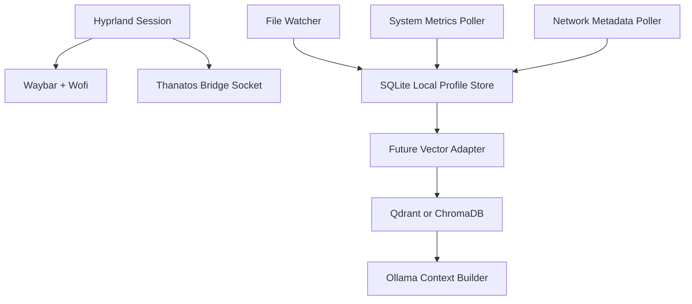

# Thanatos OS Native Architecture

Thanatos OS has two tracks:

- `web shell`: the Vite/React desktop prototype already in this repo.
- `native shell`: an Arch Linux + Hyprland environment for Chromebook hardware or a dedicated Linux install.

The native shell is the real operating environment. Hyprland owns windows and GPU compositing, Waybar owns fast system telemetry, and local daemons provide controlled access to files, metrics, and future AI memory.

## Build Order

1. Native UI shell: Arch base, Hyprland, Waybar, Wofi, foot, grim, slurp, wl-clipboard.
2. Hardware daemon: local Unix socket, allowlisted commands, no network exposure.
3. Ingestion daemon: explicit allowlisted directories, local SQLite profile store, system metrics snapshots.
4. Vector memory: Qdrant or ChromaDB behind a local-only service.
5. Ollama reasoning: retrieve relevant snippets, inject context, run local model.

## Security Rules

- No hidden file indexing. Every watched directory must be declared in `native/ingestion/config.example.json` or the user config copied from it.
- No packet capture by default. Network collection starts with interface, route, and connection metadata. Raw PCAP capture requires a separate explicit config flag and elevated privileges.
- No shell execution over HTTP. The bridge uses a Unix domain socket and an allowlist.
- No secret indexing. The ingestor skips `.env`, key files, credential stores, browser profiles, SSH keys, and common token-bearing files.
- Private/adult app data stays local, encrypted, and user-initiated.

## Native Components

## Chromebook Notes

Use the native track only on a Chromebook model that supports your chosen Linux install path. For early development, test in a VM or spare machine first. Keep the web shell as the safe prototype while native configs mature.
